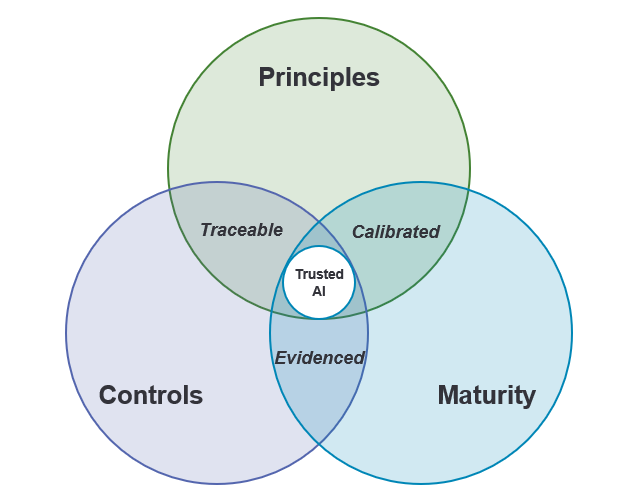

# Ballast AI Security Framework

**An open, vendor-neutral control framework for enterprise AI security**

**Authors:** [Raoul Hira](https://www.linkedin.com/in/raoulhira) and [Avishkar (Avi) Nikum](https://www.linkedin.com/in/avinikum)

[](CHANGELOG.md) [](KNOWN-GAPS.md) [](https://creativecommons.org/licenses/by/4.0/)

The Ballast AI Security Framework ("Ballast" for short) is a vendor-neutral control framework for the enterprise that builds, buys and uses AI. It covers copilots and assistants, AI features embedded in SaaS, AI coding assistants and coding agents, custom AI applications and agents, and externally sourced models, with particular attention to agents that hold credentials, call tools and act on content they did not write.

It defines **128 controls across 8 domains**, organized into [Control Tiers](guides/tiering.md#control-tiers) [T1](guides/tiering.md#t1)/[T2](guides/tiering.md#t2)/[T3](guides/tiering.md#t3) and scoped by capability, so each AI asset carries only the controls that match what it can do. Of the 128, 86 are implemented for each AI asset, 37 once by the organization's AI security program, and 5 once per AI vendor. Controls are mapped, indicatively, to the [OWASP Top 10 for LLM Applications 2026](https://github.com/GenAI-Security-Project/GenAI-LLM-Top10/blob/main/2026/README.md), the [OWASP Top 10 for Agentic Applications 2026](https://genai.owasp.org/resource/owasp-top-10-for-agentic-applications-for-2026/), [MITRE ATLAS](https://github.com/mitre-atlas/atlas-data/releases/tag/v2026.09) (release 2026.09), [NIST AI RMF 1.0](https://doi.org/10.6028/NIST.AI.100-1) and [ISO/IEC 42001:2023](https://www.iso.org/standard/42001).

**Status:** v1.0.0, the first public release. Practitioner-authored; not yet independently validated. Feedback welcome via issues. What v1.0 does not yet cover is listed in [Known gaps and roadmap](KNOWN-GAPS.md).

## Three spheres: principles, controls and maturity

Ballast is organized in three overlapping spheres that together give a 360-degree view of generative and agentic AI risk:



| Sphere | Question it answers | What it provides | Where |
|---|---|---|---|
| **1. Principles** | How should we think about AI risk? | Two-way guardrails: protect our agents from the world, and protect ourselves from our agents. Eight principles state the intent behind every control. | [Core principles](framework/principles.md) |
| **2. Controls** | What must each AI asset have in place? | 128 controls, tiered by asset risk rating and [autonomy level](guides/tiering.md#autonomy-levels) and applied by capability tags. | [Controls](controls/), [domains](framework/domains/), [tiering](guides/tiering.md) |
| **3. Maturity** | How do we know we are improving? | Per-asset coverage metrics and assessment templates; program maturity measured with the [CSA AI Security Maturity Model (AISMM)](https://cloudsecurityalliance.org/artifacts/ai-security-maturity-model). | [Adoption guide](guides/adoption.md), [AISMM alignment](mappings/crosswalk.md#csa-ai-security-maturity-model-aismm-alignment), [optional maturity scorecard](guides/maturity/README.md) |

The spheres matter most where they overlap. **Traceable:** every principle maps to the baseline controls that implement it. **Evidenced:** every control produces assessment evidence that the metrics roll up. **Calibrated:** The asset's risk rating sets its required controls. Use [CSA AISMM](https://cloudsecurityalliance.org/artifacts/ai-security-maturity-model) separately to assess the maturity of the organization's AI security program. Asset risk helps prioritize improvements.

This structure follows the ISC2 Security Congress 2026 talk *Beyond the Prompt: A 360-Degree "Tri-Sphere" Approach to Gen AI Risk*.

## Why the name Ballast

Ballast is the weight carried low in a ship's hull. You rarely see it, but it keeps the ship upright as it takes on cargo, and it lets the ship carry more sail without capsizing. The framework aims to do the same for enterprise AI. Its controls sit below the surface, outside the model, and they grow with the load: more risk and more [autonomy](guides/tiering.md#autonomy-levels) bring more controls ([T2](guides/tiering.md#t2) for High and Critical assets, [T3](guides/tiering.md#t3) for agents at [A4](guides/tiering.md#a4)). The goal is not to slow AI down. It is to let an organization adopt more AI, and give agents more [autonomy](guides/tiering.md#autonomy-levels), while staying steady.

## Who it is for

- **Security architects and engineers** designing controls for AI applications, agents and the platforms they run on.
- **GRC and audit teams** assessing AI risk and evidencing control coverage per asset.
- **Platform and engineering teams** building or deploying AI applications, agents, MCP servers and coding tools.
- **Procurement and third-party risk teams** evaluating AI vendors, plans and models.
- **AI governance and model-risk owners** who take on the non-security obligations Ballast hands off ([BAL-1.12](controls/control-catalog.md#bal-1-12)).

## The 8 domains

| # | Domain | Focus | Controls | [T1](guides/tiering.md#t1) | [T2](guides/tiering.md#t2) | [T3](guides/tiering.md#t3) |
|---|---|---|---|---|---|---|
| 1 | [AI Governance, Inventory & Classification](framework/domains/01-ai-governance-inventory-and-classification.md) | Policy, roles, inventory, risk rating, intake and retirement of AI assets | 15 | 14 | 1 | 0 |
| 2 | [Agent Identity, Authentication & Lifecycle](framework/domains/02-agent-identity-authentication-and-lifecycle.md) | Agents as governed non-human identities; delegated and third-party AI grants | 13 | 8 | 4 | 1 |
| 3 | [Delegated Authorization & Least Agency](framework/domains/03-delegated-authorization-and-least-agency.md) | [Autonomy levels](guides/tiering.md#autonomy-levels), tool policy, human approval, kill switch and spend limits | 13 | 8 | 5 | 0 |
| 4 | [Data Security, Provenance & Trust](framework/domains/04-data-security-provenance-and-trust.md) | Classification, retrieval, memory, retention, training data and model weights | 16 | 9 | 6 | 1 |
| 5 | [Secure AI SDLC & Supply Chain](framework/domains/05-secure-ai-sdlc-and-supply-chain.md) | Threat modeling, testing, change, models, MCP servers, skills and AI-generated code | 23 | 16 | 7 | 0 |
| 6 | [Runtime Guardrails & Containment](framework/domains/06-runtime-guardrails-and-containment.md) | Authority outside the model, rendering, isolation, egress and platform configuration | 22 | 13 | 8 | 1 |
| 7 | [Observability, Detection & Response](framework/domains/07-observability-detection-and-response.md) | Action audit, protected logging, detection and AI incident response | 13 | 4 | 8 | 1 |
| 8 | [Third-Party, Vendor & Shadow AI Risk](framework/domains/08-third-party-vendor-and-shadow-ai-risk.md) | Vendor terms and assurance, unsanctioned AI and supplier use of AI | 13 | 11 | 2 | 0 |
| | **Total** | | **128** | **83** | **41** | **4** |

## Control Tiers

| [Control Tier](guides/tiering.md#control-tiers) | Name | When it applies |
|---|---|---|
| [T1](guides/tiering.md#t1) | Baseline | Every in-scope AI asset, for the [T1](guides/tiering.md#t1) controls whose capability tags it carries, plus the program and vendor baseline. In scope includes pilots and developer tools that touch real organizational data, users, identities or credentials. |
| [T2](guides/tiering.md#t2) | Elevated risk | Assets rated High or Critical under the [BAL-1.5](controls/control-catalog.md#bal-1-5) risk rating: reach to restricted or regulated data, [autonomy](guides/tiering.md#autonomy-levels) at [A3](guides/tiering.md#a3) or above or the EXEC tag, untrusted input combined with sensitive access and an outbound channel or external users, or consequential decisions about individuals. |
| [T3](guides/tiering.md#t3) | Advanced | Required for any asset with an action class at [autonomy level](guides/tiering.md#autonomy-levels) [A4](guides/tiering.md#a4); recommended for Critical assets; optional additional protection otherwise. |

Applicability is set by capability tags (for example AGENT, RAG, EXEC, UNTRUSTED, MEM), so "not applicable" is derived from what an asset can do and is never chosen ad hoc. [Autonomy](guides/tiering.md#autonomy-levels) is recorded per action class on a five-level scale, from [A0](guides/tiering.md#a0) Read-only to [A4](guides/tiering.md#a4) [High autonomy](guides/tiering.md#autonomy-levels), and raising a level, or deploying an agent above [A2](guides/tiering.md#a2), requires evidence at a promotion gate ([BAL-3.1](controls/control-catalog.md#bal-3-1)). Tags, the risk rubric, [autonomy levels](guides/tiering.md#autonomy-levels) and exception rules: [Control Tiers](guides/tiering.md).

### What [T1](guides/tiering.md#t1) means in practice

Asset-level controls for five common asset types, using the capability tags shown:

| Example asset | Capability tags | Asset [T1](guides/tiering.md#t1) | Added [T2](guides/tiering.md#t2) if rated High | [T3](guides/tiering.md#t3) ([A4](guides/tiering.md#a4) only) |
|---|---|---|---|---|
| Embedded SaaS copilot (vendor-operated) | RAG, UNTRUSTED, MEM | 15 | 3 | 0 |
| Internal RAG assistant built in-house | BUILT, RAG | 21 | 16 | 1 |
| AI coding agent on endpoints | CODE, ENDPOINT, AGENT, ACT, EXEC, EXT, UNTRUSTED | 28 | 9 | 1 |
| Custom autonomous agent | BUILT, AGENT, ACT, AUTO, UNTRUSTED, RAG, EXT, MEM | 43 | 27 | 3 |
| Self-hosted model application | BUILT, MODEL, INFRA, RAG | 27 | 19 | 1 |

The program and vendor baseline are implemented once and inherited by every asset: **23 [T1](guides/tiering.md#t1) controls** for every organization, plus **up to 10** more when the organization has endpoint AI, low-code agent builders, extensions or MCP servers, or AI coding tools. An asset with the EXEC tag or any action class at [A3](guides/tiering.md#a3) is rated at least High, so the coding agent and the autonomous agent above always carry their [T2](guides/tiering.md#t2) controls. Many asset-level controls can be implemented once on a shared platform and inherited by the assets onboarded to it. A full assessment of one asset is shown in the [worked example](guides/worked-example.md).

## Core principles

The intent behind the controls is summarized in eight [core principles](framework/principles.md), each with the controls that implement it:

1. Know what you run, and where it came from
2. Agents are identities
3. Least agency, [earned autonomy](guides/tiering.md#autonomy-levels)
4. Untrusted content never grants authority
5. Protections follow the data
6. Test like an attacker, on every change
7. Every action attributable, every policy decision explained
8. Contain first: a tested off-switch and a small blast radius

## Quick start

1. Read the [core principles](framework/principles.md) (two minutes) and the [glossary](framework/glossary.md) for terms such as AI asset, agent, untrusted content and [autonomy level](guides/tiering.md#autonomy-levels).
2. Build your AI inventory first ([Domain 1](framework/domains/01-ai-governance-inventory-and-classification.md)). Register each asset with an owner ([BAL-1.4](controls/control-catalog.md#bal-1-4)), capability tags and a risk rating ([BAL-1.5](controls/control-catalog.md#bal-1-5)) in the [asset register template](guides/asset-register-template.csv). Every other control attaches to it.
3. Derive each asset's applicable controls from its tags and rating using [Control Tiers](guides/tiering.md), and implement the program and vendor baseline once.
4. Assess with the [assessment template](guides/assessment-template.csv) and record any exception in the [exceptions log](guides/exceptions-log-template.csv) ([BAL-1.13](controls/control-catalog.md#bal-1-13)). The [worked example](guides/worked-example.md) shows a completed assessment.
5. Follow the [adoption guide](guides/adoption.md) for sequencing and reporting, and check [Known gaps](KNOWN-GAPS.md) for what v1.0 does not yet cover.

## Repository structure

```
ballast/
├── README.md                          This overview
├── framework/
│   ├── principles.md                  Core principles and the controls that implement them
│   ├── glossary.md                    Defined terms
│   └── domains/                       One page per domain: objective, risks, controls
├── controls/
│   ├── control-catalog.md             All controls, human-readable
│   └── control-catalog.csv            All controls, machine-readable (source of truth)
├── mappings/
│   ├── crosswalk.md                   Mappings to OWASP, MITRE ATLAS, NIST AI RMF, ISO/IEC 42001
│   └── control-mappings.csv           Control-level mappings, machine-readable
├── guides/
│   ├── tiering.md                     Control Tiers, capability tags, risk rubric, autonomy levels, exceptions
│   ├── adoption.md                    Adoption path and assessment method
│   ├── worked-example.md              One asset assessed end to end
│   ├── assessment-template.csv        Per-asset control assessment worksheet
│   ├── asset-register-template.csv    AI asset register with tags and risk rating
│   ├── exceptions-log-template.csv    Exception and risk-acceptance log
│   └── maturity/                     Optional program maturity aid
│       ├── README.md                 Purpose, use and scoring guidance
│       └── AI_Security_Maturity_Scorecard_AISMM_template.xlsx
├── KNOWN-GAPS.md                      What v1.0 does not yet do, and the roadmap
├── CHANGELOG.md                       Release history
├── CITATION.cff
├── CONTRIBUTING.md
├── SECURITY.md
├── CODE_OF_CONDUCT.md
└── LICENSE
```

## Control IDs

Controls are identified as `BAL-<domain>.<n>`, for example [`BAL-3.5`](controls/control-catalog.md#bal-3-5) (Untrusted-input capability separation). IDs are stable: new controls are appended, a withdrawn control keeps its ID and is marked as withdrawn, and IDs are never reused. Cite the ID and framework version together, for example "Ballast v1.0.0, [BAL-3.5](controls/control-catalog.md#bal-3-5)". The full policy is in [CONTRIBUTING.md](CONTRIBUTING.md#control-id-policy).

## How Ballast relates to other frameworks

- **[ISO/IEC 42001:2023](https://www.iso.org/standard/42001)** specifies an AI management system. Ballast supplies security controls such a system can select, and maps to its Annex A.
- **[NIST AI RMF 1.0](https://doi.org/10.6028/NIST.AI.100-1)** defines a risk-management process (Govern, Map, Measure, Manage). Ballast maps to its subcategories.
- **[CSA AI Controls Matrix (AICM)](https://cloudsecurityalliance.org/artifacts/ai-controls-matrix-v1-1) v1.1** is a broad control matrix for the whole AI stack (247 control objectives across 18 domains) that assigns responsibilities across roles in the AI supply chain. A control-level mapping is on the [roadmap](KNOWN-GAPS.md).
- **[CSA AI Security Maturity Model (AISMM)](https://cloudsecurityalliance.org/artifacts/ai-security-maturity-model)** measures the maturity of an AI security program. Ballast lists controls; AISMM can measure the program that runs them.
- **[AIUC-1](https://www.aiuc-1.com/)** is a standard for third-party certification of AI agents. Ballast is not a certification scheme; an organization may accept [AIUC-1](https://www.aiuc-1.com/) or similar assurance from vendors under [BAL-8.5](controls/control-catalog.md#bal-8-5).
- **[OWASP Top 10 for LLM Applications 2026](https://github.com/GenAI-Security-Project/GenAI-LLM-Top10/blob/main/2026/README.md)**, the **[OWASP Top 10 for Agentic Applications 2026](https://genai.owasp.org/resource/owasp-top-10-for-agentic-applications-for-2026/)** and **[MITRE ATLAS](https://github.com/mitre-atlas/atlas-data/releases/tag/v2026.09)** are threat taxonomies. Ballast maps its controls to them.
- Related work on [earned autonomy](guides/tiering.md#autonomy-levels) and capability separation includes the [Agentic Trust Framework](https://cloudsecurityalliance.org/blog/2026/02/02/the-agentic-trust-framework-zero-trust-governance-for-ai-agents) (J. Woodruff, published on the CSA blog, Feb 2026), the [AWS Agentic AI Security Scoping Matrix](https://aws.amazon.com/ai/security/agentic-ai-scoping-matrix/) (Nov 2025) and Meta's "[Agents Rule of Two](https://ai.meta.com/blog/practical-ai-agent-security/)" (Oct 2025).
- Ballast is an open, deployer-side, agent-first control catalog for the enterprise that builds, buys and uses AI. It is meant to complement these frameworks, not replace them.

## Scope and limitations

- Ballast addresses AI-specific risk. It complements, and does not replace, general security control frameworks such as [ISO/IEC 27001](https://www.iso.org/standard/27001), [NIST SP 800-53](https://csrc.nist.gov/pubs/sp/800/53/r5/upd1/final) and the [CIS Controls](https://www.cisecurity.org/controls). Where a control touches general hygiene, it states only what AI changes.
- Fairness and bias validation and model performance validation belong to model-risk and AI governance processes. [BAL-1.12](controls/control-catalog.md#bal-1-12) hands them to a named owner along with the asset's security test results.
- Defending the enterprise against AI-enabled attackers (for example deepfakes and AI-assisted phishing) is general security program territory; see the [NIST Cyber SI Profile](https://www.nccoe.nist.gov/projects/cyber-si-profile) project and its [NIST IR 8596](https://csrc.nist.gov/pubs/ir/8596/iprd) initial preliminary draft, published as *Cybersecurity Framework Profile for Artificial Intelligence ([Cyber AI Profile](https://csrc.nist.gov/pubs/ir/8596/iprd)): NIST Community Profile* (16 December 2025).
- Ballast is not a certification scheme. The [mappings](mappings/crosswalk.md) are indicative: a mapping does not establish conformance with the referenced framework or compliance with any law.
- Controls describe outcomes, not products. Any combination of tools and processes that achieves the outcome satisfies the control.

## Use of the name

- The full name is **Ballast AI Security Framework**. "Ballast" is the short form, and control IDs use the prefix `BAL-`. Use the full name in titles and first references.
- The CC BY 4.0 license covers the content, not the name: it grants no trademark rights (Section 2(b)(2)). You may refer to the framework by name to describe your use of it, but do not imply endorsement by the authors.
- Ballast is not a certification, and there is no "Ballast-certified" status.
- Suggested claim wording: "self-assessed against Ballast v1.0.0, [T1](guides/tiering.md#t1) scope", stating the assets in scope and the assessment date.
- Adapted versions must be clearly marked as modified, as CC BY 4.0 Section 3(a)(1)(B) requires, and should not be presented as Ballast itself.

## Disclaimer

- Ballast is not legal, regulatory, audit or insurance advice. Implementing it does not by itself demonstrate compliance with any law, regulation or standard.
- References to NIST, ISO/IEC, OWASP, MITRE, CSA and other organizations identify sources only and do not imply their endorsement. Names are trademarks of their respective owners.
- The views expressed are the authors' own and do not represent any employer.
- No vendor sponsored Ballast. The framework is vendor-neutral, and organizations can choose how to implement its controls and which vendors or products to use.
- Ballast is provided as-is and as-available, without warranties of any kind; see Section 5 of the [LICENSE](LICENSE).

## Contributing

Issues and pull requests are welcome, especially on this first release: unclear or untestable controls, coverage gaps, mapping corrections and results from pilots. See [CONTRIBUTING.md](CONTRIBUTING.md) and [Known gaps](KNOWN-GAPS.md). Report anything sensitive privately as described in [SECURITY.md](SECURITY.md). Participation is governed by the [Code of Conduct](CODE_OF_CONDUCT.md).

## License

Copyright © 2026 [Raoul Hira](https://www.linkedin.com/in/raoulhira) and [Avishkar (Avi) Nikum](https://www.linkedin.com/in/avinikum).

Ballast is licensed under [Creative Commons Attribution 4.0 International (CC BY 4.0)](LICENSE). You may share and adapt it for any purpose, including commercially, provided you give appropriate credit, link to the license, and indicate if changes were made.

Suggested attribution: *"Ballast AI Security Framework" by Raoul Hira and Avishkar (Avi) Nikum, [https://github.com/Ballast-Framework/Ballast](https://github.com/Ballast-Framework/Ballast), licensed under CC BY 4.0.*
